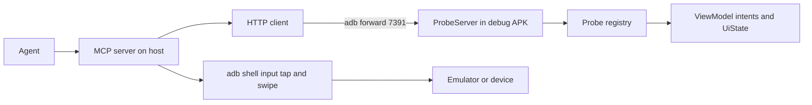

# Probe MCP

An MCP control plane for the Harold debug app, built so an agent can drive the
phone in one round trip per intent instead of dumping and parsing uiautomator
trees.

The proof is in [`run-poc.sh`](./run-poc.sh): it adds an SSH connection to the
real app using only MCP tool calls, and records the screen while it happens. The
full walk, from launching the app to landing on the chat screen, runs in about
nine seconds.

## Why MCP lives on the host

MCP is a wire shape, not a capability. Implementing `initialize`, `tools/list`,
and `tools/call` in Kotlin would hard-code a protocol version inside an APK and
put a network listener in a binary whose pitch is "your keys, your host".

So the split is:

| Layer | Where | What it does |
| --- | --- | --- |
| MCP server | host, this package | tool schemas, validation, adb gestures, waiting |
| Control plane | debug APK only | `127.0.0.1:7391`, plain JSON, four routes |
| Probe registry | app process | per-screen facts, named actions, control rects |



## Device side

Three files, all inert unless the debug initializer runs.

| File | Role |
| --- | --- |
| [`Probe.kt`](../../../../apps/android/design/src/main/java/harold/android/ui/debug/Probe.kt) | `ScreenProbe` contract, control and mark registry, `Modifier.probeTag` |
| [`SshSetupProbe.kt`](../../../../apps/android/connections/src/main/java/harold/android/connections/SshSetupProbe.kt) | adapter for the SSH host form |
| [`ProbeServer.kt`](../../../../apps/android/app/src/debug/java/harold/android/debug/ProbeServer.kt) | loopback HTTP routes, token, JSON |

- `GET /screen` returns the screen id, state facts, `settled`, and every control
  with its device-pixel rect.
- `POST /intent` runs a named action and returns the new snapshot plus the marks
  it produced.
- `GET /marks` and `POST /marks/clear` handle the device clock ledger.
- `POST /anchor` samples `elapsedRealtimeNanos` for converting marks to host time.

Typing runs inside the app, one character at a time, writing a `key` mark before
each character and a `keys_done` at the end. That is the same grammar
[`build_capture.py`](../build_capture.py) already parses, and the cadence is now
real instead of inferred.

## Tools

| Tool | Purpose |
| --- | --- |
| `harold_screen` | screen id, facts, settled flag, controls with rects |
| `harold_tap` | resolve a tag to its rect, issue a real adb tap |
| `harold_scroll_to` | swipe until the tag has non-zero bounds |
| `harold_type` | type a whole value at a fixed gap, verify what landed |
| `harold_set` | instant set, pre-roll only |
| `harold_intent` | non-gesture actions such as `test_connection` and `save` |
| `harold_wait` | block on a fact or on `settled`, replacing blind sleeps |
| `harold_navigate` | reach a route by intent, for pre-roll only |
| `harold_marks` / `harold_clear_marks` | read and reset the device ledger |
| `harold_anchor` | device clock sample for mark conversion |

Anything the video is supposed to show happening goes through `harold_tap` or
`harold_type`. `harold_set` and `harold_navigate` are for reaching a slice, never
for the slice itself, otherwise the demo can show a flow a user cannot walk.

## Run it

```sh
# emulator up, then
ANDROID_SERIAL=emulator-5554 bash docs/demo/capture/mcp/run-poc.sh
```

That builds and installs `harold.android.debug` on the selected device only,
starts the fake host, reverses port 2223, forwards port 7391, cold starts the
app, reads the probe token from logcat, records the screen, runs the walk, and
pulls the video.

Artifacts land in `docs/demo/work/probe-poc/`:

- `poc.mp4` the recording
- `report.json` every step with its tool response, plus all device marks
- `final.png` the screen after the save

To wire an agent to the same server yourself:

```sh
HAROLD_PROBE_TOKEN=<from adb logcat -s HaroldProbe:I> bun run src/server.ts
```

`src/server.ts` is a stdio MCP server. Point any MCP client at it.

Wiring check with no device:

```sh
bun run src/smoke.ts
```

## What the POC showed

Same connect flow the old driver took four hundred and fifty five seconds to
cover, in nine and a half seconds:

| Step | Time |
| --- | --- |
| navigate to the form | 0.8 s |
| type host, user, port, name | 2.4 s total |
| read the generated public key from facts | 2.4 s |
| scroll and tap Test connection | 5.6 s |
| fingerprint present | 6.2 s |
| trust, save, land on chat | 9.5 s |

There is no uidump anywhere in that path.

## Limits, on purpose

- The SSH form is the only instrumented screen. Adding one is a `ScreenProbe`
  adapter plus tags, not a framework change.
- Compose reports an empty rect for a fully clipped control, so a tag alone is
  not enough to tap something below the fold. `harold_scroll_to` covers it and
  `harold_tap` refuses to tap a zero-sized control rather than clicking at 0,0.
- `harold_type` uses the hoisted Compose value, not the IME. It repaints glyph by
  glyph, which is what the video needs, but it bypasses the keyboard. Do not use
  it on a field with a live composition session.
- The renderer's ripple layer still needs `taps[].x/.y`. `harold_tap` returns the
  coordinates it used so they can be written into `capture.json`.
- Marks are on the device clock. Convert with `harold_anchor` paired against a
  host timestamp, exactly as the calibration blink does today. The POC records
  raw marks and does not convert them.
- A loopback listener exists only in debug source. `Probe.enabled` starts false
  and only `ProbeInitializer`, which is in the debug manifest, turns it on.
