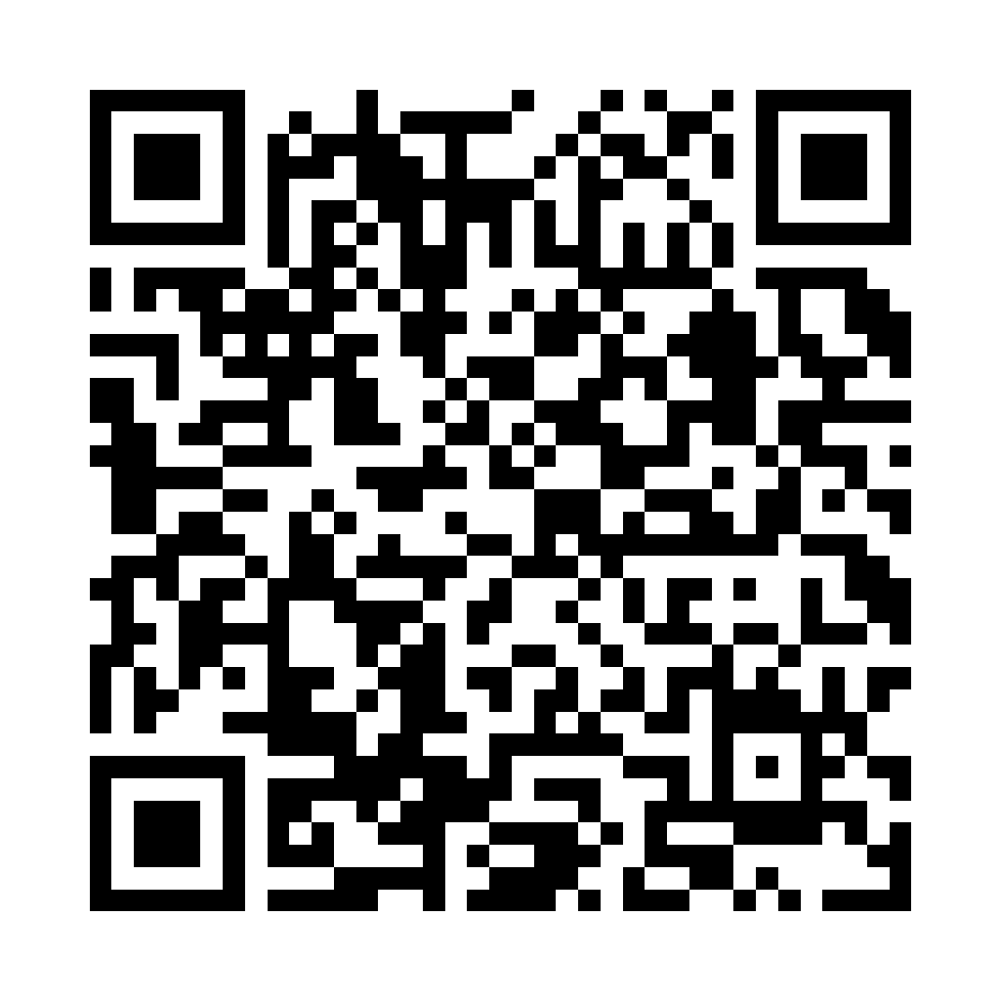

# Android store assets

Ready-to-upload Google Play assets for the Harold Android app. The listing copy is in [store-listing.md](./store-listing.md). The privacy policy draft is in [privacy-policy.md](./privacy-policy.md).

## Review pairing

The public demo server runs at `https://harold-demo.codenamegary.com`. A Play reviewer can scan the QR code below with the app, or enter the endpoint and code by hand.



- Endpoint: `https://harold-demo.codenamegary.com`
- Pairing code: `DEM-O01`
- Hosted QR: `https://harold-demo.codenamegary.com/review-pairing-qr.png`

The demo server serves the same QR at the hosted URL, so the public image and the file in this folder cannot drift. The demo server accepts any code shaped `XXX-XXX`, so this code does not expire. See [apps/demo-server/README.md](../../apps/demo-server/README.md) for the demo data and privacy notes.

## Foreground service declaration

Google Play requires a declaration and a demo video for the `specialUse` foreground service.

- Video: `https://harold-demo.codenamegary.com/foreground-service-demo.mp4`
- File: `foreground-service-demo.mp4`
- Type: `specialUse`

Harold keeps a live session event stream open while a session is starting, running, or waiting for input. A persistent notification shows the live state. The notification tells the user when a session needs an answer. The service stops when no sessions are active.

## Files

| File                           | Use                  | Spec                                  |
| ------------------------------ | -------------------- | ------------------------------------- |
| `app-icon-512x512.png`         | Play store icon      | 512 x 512 PNG, opaque, under 1 MB     |
| `feature-graphic-1024x500.png` | Play feature graphic | 1,024 x 500 PNG, under 15 MB          |
| `review-pairing-qr.png`        | Review pairing QR    | 1,024 x 1,024 PNG, under 1 MB         |
| `foreground-service-demo.mp4`  | Play FGS demo video  | H.264 MP4, 1,080 x 2,400, under 20 MB |
| `phone-01-pairing.png`         | Phone screenshot 1   | 1,080 x 1,920 PNG, 9:16, under 8 MB   |
| `phone-02-sessions.png`        | Phone screenshot 2   | 1,080 x 1,920 PNG, 9:16, under 8 MB   |
| `phone-03-plan.png`            | Phone screenshot 3   | 1,080 x 1,920 PNG, 9:16, under 8 MB   |
| `phone-04-answer.png`          | Phone screenshot 4   | 1,080 x 1,920 PNG, 9:16, under 8 MB   |
| `phone-05-build.png`           | Phone screenshot 5   | 1,080 x 1,920 PNG, 9:16, under 8 MB   |
| `phone-06-changes.png`         | Phone screenshot 6   | 1,080 x 1,920 PNG, 9:16, under 8 MB   |
| `phone-07-worktrees.png`       | Phone screenshot 7   | 1,080 x 1,920 PNG, 9:16, under 8 MB   |
| `phone-08-ship.png`            | Phone screenshot 8   | 1,080 x 1,920 PNG, 9:16, under 8 MB   |

## Sources

- The icon uses the slanted prism from `apps/android/app/src/main/res/drawable/ic_launcher_foreground.xml` on the brand lime background.
- The feature graphic uses the Geist and Geist Mono fonts from Google Fonts. The font files and OFL license are in `src/fonts`.
- The review pairing QR encodes the demo server endpoint and code as a `harold://pair` URI. The generator lives in `src/pairing-qr.ts`, and the demo server serves the image at `/review-pairing-qr.png`.
- The foreground service video was recorded on the Android app paired to the demo server. It shows a session asking for an answer while the app is backgrounded. The demo server is a fake Harold, so no real workspace or credential appears.
- The screenshots come from the recorded demo slices in `docs/demo/render/public/slices`. The build script extracts one stable frame from each clip.

## Rebuild

Needs ImageMagick, ffmpeg, a Chrome binary, and Bun.

```sh
bash docs/store-android/src/build-assets.sh
```

The script rebuilds the icon, feature graphic, review pairing QR, and all eight screenshots. Set `CHROME` if Chrome is not on the path. It does not rebuild the foreground service video. Re-record that from the app paired to the demo server when the notification UI changes.

## Validate

The store asset check verifies the Play size, dimension, format, and aspect ratio limits. It also checks that the review pairing QR matches the demo server URI:

```sh
bun test scripts/checks/store-assets.test.ts
```

## Upload order

1. App icon
2. Feature graphic
3. Phone screenshots in numbered order

Play shows the screenshots left to right. The numbered order tells the story from pairing to shipping a pull request.
